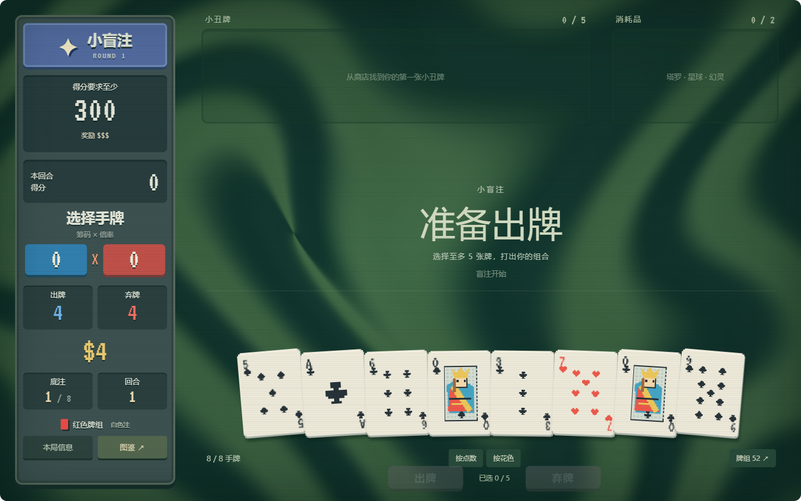

# Balatro Web

小丑牌玩法复刻与可嵌入网页的游戏 SDK。游戏完全在浏览器内运行，默认全解锁，没有局外成长；同一套规则内核也能在 Node 或 Worker 中无界面执行。

当前是以 1.0.1 系列公开规则为基线的可玩初版，尚未完成与原版的全量实机差分校验。本仓库独立包含游戏、SDK、资源、视觉样片、研究文档和验证脚本。



## 启动

需要 Node.js 22.12+，建议使用当前 LTS；浏览器验收使用 Google Chrome。

```sh
git clone https://github.com/sqchenxiyuan/balatro-web.git
cd balatro-web
npm ci
npm run dev
```

- [正常游玩](http://127.0.0.1:5192/)：选择牌组、难度和种子，手动完成一局。
- [SDK 接入示例](http://127.0.0.1:5192/sdk-demo.html)：双实例、策略代码编辑、模块导入、自动运行、单步和停止。
- [历史视觉样片](http://127.0.0.1:5192/#materials)：材质、图鉴和消耗品实验。

```sh
npm run build
npm run preview
```

生产预览地址为 [127.0.0.1:4192](http://127.0.0.1:4192/)。`dist/` 是完整静态站点，可部署至普通静态托管服务；开发和预览进程关闭后，本机地址会停止服务。

## 玩法与交互

- 15 牌组、8 注码；150 小丑、52 消耗品、32 优惠券、30 盲注、24 标签，以及五类包的普通、巨型、超级规格。
- 选盲注、出牌与弃牌、逐步计分、领取奖励、商店构筑、开包，以及 Ante 8 通关和无尽模式。
- 点击选择手牌，拖动手牌和小丑调整顺序；右键清空选择，Enter 出牌，D 弃牌。
- 开局菜单和局内左侧均可打开图鉴，支持中文、英文、拼音全拼、首字母及效果搜索；中文组词期间保持输入框和牌面稳定。
- 主页面自动保存当前局；SDK 由宿主决定存档方式。新开一局会重置局内构筑，不保留局外奖励。

## SDK 与策略

```js
import {mountBalatro, createStrategyRunner} from './dist-sdk/sdk.js';

const game = mountBalatro(document.querySelector('#game'), {
  seed: 'AI-TEST-001',
  deck: 'red_deck',
  stake: 0,              // 0～7：白注到金注
  startInMenu: false,    // 直接进入选盲注
  speed: 2,
  sound: false,
});

const runner = createStrategyRunner(game, (state, {signal}) => {
  if (signal.aborted) return null;
  if (state.phase === 'blind_select') return {type: 'select_blind'};
  return null; // 后续决策由策略实现
});

await runner.step();
console.log(game.getState());
// 离开宿主页面时：runner.destroy(); game.destroy();
```

核心操作接口为 `getState()` 和 `dispatch(action)`，没有游戏服务器或 `subscribe`。挂载视图使用 Shadow DOM 隔离宿主样式和键盘，支持多实例、销毁与重新挂载。

`seed`、`deck`、`stake` 是开局参数；`state` 用于恢复已有快照。初始金币、指定小丑、起始底注和自定义牌库目前没有独立配置项。运行时可调用 `game.setOptions({speed, sound, reducedMotion})` 调整显示选项，或通过 `dispatch({type:'new_run', seed, deck, stake})` 重新开局。

```sh
npm run build:sdk
npm run pack:sdk
```

`dist-sdk/` 包含独立 ESM、TypeScript 声明、美术资源和普通 HTML 接入示例。可安装包输出到 `artifacts/game-rebuild-balatro-0.2.0.tgz`，包名为 `@game-rebuild/balatro`；依赖已打包，无需宿主另行安装运行时依赖。

无界面执行使用同一内核：

```js
import {createGame} from './dist-sdk/engine.js';
const game = createGame({seed:'BATCH-1', deck:'blue_deck', stake:0});
game.dispatch({type:'select_blind'});
console.log(game.getState());
```

策略应为可信函数。策略生成、未知代码沙箱、批量调度和记录展示属于接入平台。

## 验证

```sh
npm run check
npm test
npm run build
npm run test:sdk
npm run test:sdk:browser
npm run test:sdk:package
```

页面验收需要一个已启动的服务。`npm run dev` 运行时可直接执行 `npm run test:game:browser` 和 `npm run test:sdk:host`。验证生产构建时，先运行 `npm run preview`，再在另一个终端设置：

```powershell
$env:BALATRO_DEMO_URL = 'http://127.0.0.1:4192/'
$env:BALATRO_ENGINE_MODULE = 'engine.js'
npm run test:integration
```

GitHub Actions 会从锁文件安装依赖，完成规则、SDK、生产页面和安装包验证。运行报告、截图及测试消费者目录写入 `artifacts/`，不提交版本库；本次整理的验证快照见 [docs/verification](docs/verification/)。旧视觉模块可另行执行 `test:browser` 和 `test:consumables`。

## 目录与文档

| 路径 | 内容 |
| --- | --- |
| `src/run-*.ts` | 单局规则、计分、内容、存档与实例接口 |
| `src/game-view.ts` / `src/sdk.ts` | 游戏窗口和 SDK 门面 |
| `src/strategy.ts` | 可信策略运行器 |
| `src/game-main.ts` / `sdk-demo.html` | 正常游玩外壳与接入示例 |
| `public/` | 本地运行资源、字体、来源记录与示例策略 |
| `scripts/` | 构建、生成、采集和验证脚本 |
| `docs/balatro/` | 规则、研究资料、视觉迭代、SDK 文档 |
| `research/` | 来源快照、对照图和历史视觉验收记录 |

- [SDK 接入、操作和策略](docs/balatro/21-embeddable-sdk.md)
- [MUNDI Web 接入待办（本地续玩优先；云存档后置）](docs/MUNDI_INTEGRATION_TODO.md)
- [玩法实现范围与限制](docs/balatro/20-first-playable.md)
- [全部研究文档](docs/balatro/README.md)
- [资源来源与字体许可](public/assets/THIRD-PARTY.md)

Python 仅用于可选的资料采集、结构化数据和美术生成；运行游戏及构建 SDK 不需要 Python。使用这些工具前执行 `python -m pip install -r requirements-research.txt`。`BALATRO_PYTHON` 可指定卡图采集工具所使用的 Python。

## 边界与归属

复杂小丑联动、概率和极端大数仍需原版对照；本复刻的种子序列不兼容原版，无尽增长暂用估算公式。规则覆盖与合法通关流程验证不等于正常构筑的全量通关证明。

原版卡图、名称及研究参考仍属于各自权利人。本仓库不授予原版素材的再分发许可，也不代表官方项目；详见 [NOTICE.md](NOTICE.md)、资源目录的来源说明和字体许可。源代码暂未指定开源许可证，npm 元数据为 `UNLICENSED`。
