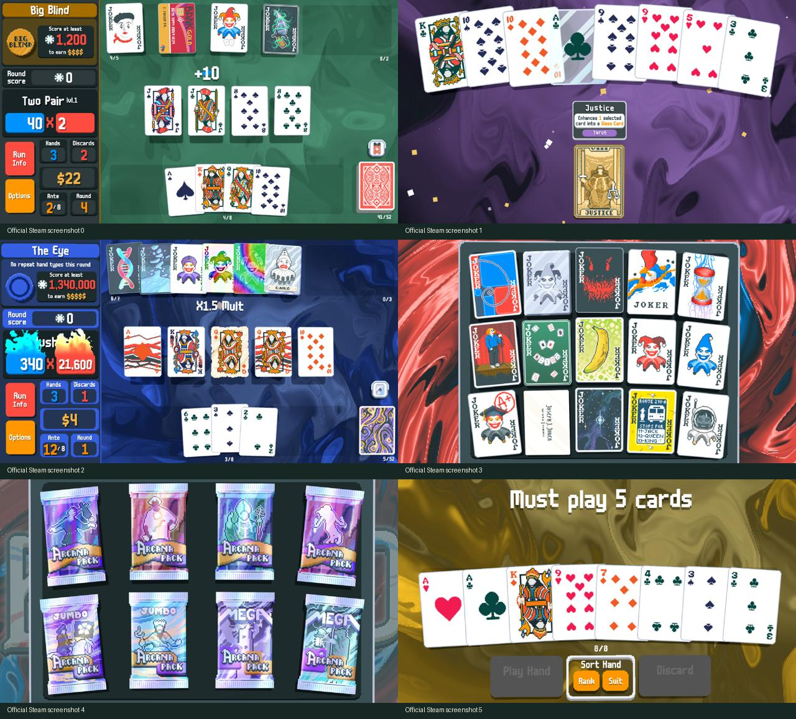
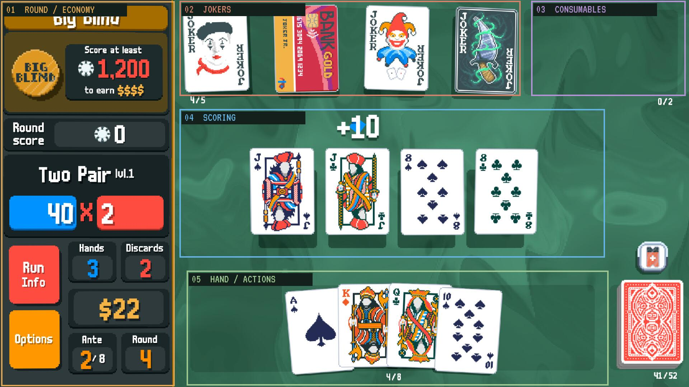

# 界面、交互与视觉反馈研究

日期：2026-11-07。目的：为 Web 复刻建立可确认的牌桌、卡牌交互与物料标准。本轮参考官方 Steam 截图、官网及社区操作/设置说明，制作了 [四组交互样片](12-lookdev-review.md)。尚未安装或运行原版做输入、音频和逐帧动画测量。

## 证据与确定性

| 依据 | 能确认什么 | 不能据此确认什么 |
| --- | --- | --- |
| Steam 官方提供的 6 张截图 | 牌桌分区、卡牌关系、按钮分组、计分配色、背景与卡包视觉方向 | 悬停/拖拽手感、动画时长、完整商店流程 |
| Wiki Controls | PC 左键选择、拖动排序、右键清空；长按 R 重开 | 输入响应延迟、拖拽阈值、卡牌弹性参数 |
| Wiki Settings | 速度、震屏、CRT、减少动态、像素平滑等选项及公开默认值 | 原版着色器实现、参数到像素结果的精确对应 |
| Wiki Shop / Scoring / Booster Packs | 商店操作、包内选择/立即使用、计分语义顺序 | 全部动画细节和罕见机制的实机表现 |
| 本轮 demo | 我们拟采用的视觉和输入手感，可实际操作 | 原版逐像素一致、完整游戏规则一致 |

官方截图研究拼图：

截图来源与文件哈希见 [reference-manifest.json](../../research/reference-manifest.json)。截图仅保存在研究目录，未作为游戏运行物料。

## 牌桌的空间结构

原版以固定信息区和大面积操作区组成桌面卡桌；卡牌是视觉主体。重要数字使用高对比、像素字体和短促变化反馈。整体不是通用仪表盘布局。

| 区域 | 原版可见结构 | 样片的设计基准 |
| --- | --- | --- |
| 左侧信息 | 当前盲注、目标/奖励、累计分数、牌型、筹码×倍率、次数、金钱、底注/回合 | 1280×720 逻辑舞台，HUD 位于 `(25,28)`，尺寸 265×653，约占宽度 23% |
| 上方构筑 | Joker 从左向右排列，容量计数；消耗品单独成区 | Joker 区从 x=337 开始，3 张初始 Joker；消耗品在右上 |
| 中央计分 | 打出的牌与逐项反馈；空闲时保留桌面空间 | 出牌从手牌移至中央，浮字与来源卡牌关联 |
| 下方手牌 | 重叠排列，选中抬升；排序、出牌、弃牌相邻 | 8 张固定手牌，点数/花色排序与左右出牌/弃牌按钮 |
| 右下牌堆 | 叠放卡背与剩余数量 | 多层阴影卡背与数量标签 |

上述坐标是样片选择，不是从原版源码取得的布局常量。官方桌面截图中的左区约占四分之一宽度，当前样片略窄；正式版需确认是否进一步向原图靠拢。长牌型名、大数值和更多 Joker 的挤压布局还需扩充。

## 卡牌输入与状态

| 输入 / 状态 | 预期反馈 | 本轮实现 |
| --- | --- | --- |
| 悬停 | 当前卡牌突出，便于在重叠区辨认 | 轻微抬升、放大、倾斜；Joker 显示说明浮层 |
| 左键单击 | 选中与取消，最多 5 张打出/弃掉 | 抬升 30 个逻辑像素，牌型与基础筹码/倍率同步预览 |
| 拖动手牌 | 改变实际手牌顺序 | 指针捕获，拖出阈值后移动，松开按位置插入 |
| 拖动 Joker | 改变从左至右的触发顺序 | 拖拽重排；样例中顺序可改变实际最终得分 |
| 右键 | 取消全部已选手牌 | 已实现，阻止舞台中的浏览器右键菜单 |
| 无有效选择 | 不应误操作 | 出牌/弃牌按钮禁用；API 返回错误而不改状态 |
| 打开包并使用目标类塔罗 | 明确选牌目标后使用 | 幻术包提供 1–3 张手牌目标选择 |

公开说明还确认长按 R 重开、主机按键和移动端点击/拖动；本轮没有实现长按 R 和主机导航，也没有对原版触屏手感做对照。窄屏当前只是桌面舞台等比缩放，不应当作移动端布局定稿。

## 计分反馈的组织

采用“先让玩家看见来源，再看见数字改变”的表现：基础牌型 → 每张参与计分的牌 → Joker 从左到右 → 版本乘算 → 总分落入左侧面板。

- 筹码变化使用蓝色，倍率使用红色；乘算倍率增加区分度。
- 浮字出现在来源卡牌附近，Joker 触发时短促弹起；左侧数值随该步骤改变。
- 总分确认有一次集中反馈，避免每个小事件都进行强震屏。
- 速度、震屏和减少动态效果均可调整；规则结果应保持一致。

完整原版还包括留手、重触发、卡牌销毁和其他条件事件。本轮只演示“对子 + 狡猾小丑 + 小丑 + 多彩半张小丑”，不声称覆盖全部计分事件。

## 商店与开包

商店包含可购买卡、优惠券、卡包、刷新和离开入口；当前 demo 取其中一组固定商品确认手感，**尚未加入优惠券区**。

| 流程 | 应保留的反馈 |
| --- | --- |
| 悬停卡牌 | 说明、价格、购买入口清楚；不与已持有卡牌混淆 |
| 购买 | 校验金额/槽位，再扣款、移走报价，卡牌进入持有区 |
| 刷新 | 先支付，商品更新；刷新价格递增；金额不足时不改变状态 |
| 打开卡包 | 支付后展示候选，包壳离场，候选牌依次出现 |
| 普通天体包 | 3 张中选择 1 张立即使用，升级后回商店 |
| 普通幻术包 | 展示 3 张塔罗及可操作手牌；目标类效果先选目标再使用 |
| 跳过卡包 | 放弃剩余选择，关闭卡包；已支付费用不退回 |

Wiki 提供的 [商店 GIF 原图](https://balatrowiki.org/images/Shop.gif) 只有 226×114、4 帧，适合辅助理解分区，不足以校准动效。该图研究副本及设置截图见 [Wiki 来源清单](../../research/wiki-reference-manifest.json)。

## 美术与特效的复刻方向

| 元素 | 原版方向 | 当前样片 / 差距 |
| --- | --- | --- |
| 卡牌 | 清楚的像素轮廓，花色、点数与图案有层次 | 自绘 71×95 基准像素，保持轮廓和信息位置；该尺寸为样片基准，未读取原版精灵文件 |
| Joker | 图像差异大，细节和视觉笑点丰富 | 第二轮改用 Wiki 收录的 150 张原版参考卡图；保留特殊轮廓与透明区域，来源和版权记录单列 |
| 文字 | 厚重像素字，浅色字配深色偏移阴影 | 本地 VT323 用于数字/拉丁文，中文为系统字体；不是原版字体还原 |
| 面板/按钮 | 暗色面板、圆角、深色下缘与压下反馈 | CSS 多层阴影和按下位移；边缘仍比原版平滑 |
| 桌面 | 缓慢有机流动，随场景/盲注改变色调 | 第二轮加强域扭曲、旋转与流速，绿色桌面、棕红商店；无 WebGL 或上下文丢失时使用动态 Canvas；不是原版 shader |
| CRT | 扫描线、shadow mask、失真与 bloom 的组合 | 可调扫描线/色栅和暗角；没有真实曲面失真与 bloom |
| 基础/闪箔/镭射/多彩/负片 | 不同版本有不同纹理与反光方式 | 按原版参考图改用同心环、三角镭射纹、油墨色相变化与深蓝负像；共用表面着色器，替换此前悬浮投影试验；仍为独立实现，见[版本效果对齐](17-original-edition-finishes.md) |
| 玻璃 | 透明高光、脆弱感和破碎反馈 | 透明牌体、表面印刷、厚边与反射；默认无裂纹，未实现销毁粒子和破碎音效 |
| 卡包 | 彩色包装、拆包、候选揭示与少量纸屑 | 5 类立体包装、凸印徽章、顶部撕封、候选错峰出现与纸屑；未还原完整拆包 shader |
| 音效 | 选择、计分、购买等不同音色和节奏 | Web Audio 合成占位音效，默认关闭；没有原版音乐与音效 |

参考资料确认原版有 `0.5 / 1 / 2 / 4` 倍速度、震屏比例、减少动态、CRT 0–100%、CRT Bloom 和像素平滑。Wiki 列出的桌面默认 CRT 为 70%、震屏 30%；样片 CRT 的 35% 是我们叠加层的强度，**不能与原版同百分比作等效比较**。

## 下一轮应优先校准

1. 原图 HUD 与当前 HUD 的比例、底部信息/选项按钮分组；本轮重开/说明按钮只是样片工具。
2. 中文像素字、数字粗细和超大数值显示。
3. Joker 插画、卡背细节、包装细节；确定最终物料来源后再铺量。
4. 悬停、选中、拖动回位和计分步长的实际手感。
5. 旋涡纹理、CRT 强度与材质叠加是否遮挡牌面。

只有在获得原版实机输入与录屏证据后，才将这些待确认值收敛成“原版对照通过”的规格。

## 来源

- [Steam 商店](https://store.steampowered.com/app/2379780/Balatro/) / [官方截图 API](https://store.steampowered.com/api/appdetails?appids=2379780&l=english&filters=basic,screenshots,movies)
- [Balatro 官网](https://www.playbalatro.com/)
- [Controls，采集页面 oldid=26878](https://balatrowiki.org/w/Controls?oldid=26878)
- [Settings，采集页面 oldid=30086](https://balatrowiki.org/w/Settings?oldid=30086)
- [Shop](https://balatrowiki.org/w/Shop)、[Scoring](https://balatrowiki.org/w/Scoring)、[Booster Packs](https://balatrowiki.org/w/Booster_Packs)
- [本次网页原文快照](data/ui-source-pages.json)、[既有玩法与版本记录](08-sources-versioning.md)
