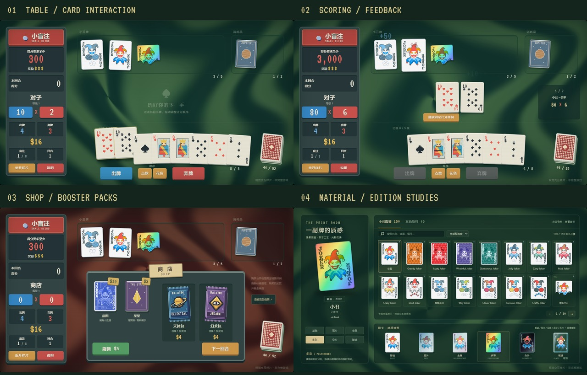

# 视觉、交互与特效样片确认

初版：2026-11-07；最新更新：2026-11-08。**本轮交付是四组可操作样片和物料稿，供确认还原方向；不是完整小丑牌游戏。** 原版依据及当前差异见 [界面交互研究](11-ui-interaction-research.md)，最新改动与截图见 [玻璃与卡包工艺](14-material-pack-polish.md)。



## 打开样片

当前本地预览：[http://127.0.0.1:5192/](http://127.0.0.1:5192/)。开发预览关闭后，可在工作区执行：

```powershell
npm run dev
```

游戏状态、操作和渲染都在浏览器里；该端口只用于提供静态页面，不是游戏状态/API 服务。

| 样片 | 入口 | 操作方法 | 截图 |
| --- | --- | --- | --- |
| 01 牌桌与选牌 | [进入](http://127.0.0.1:5192/#table) | 左键选牌；拖动手牌/Joker；右键清空；点数/花色排序；出牌/弃牌 | [牌桌](../../research/previews/01-table.png)、[已选手牌](../../research/previews/02-selection.png) |
| 02 计分与反馈 | [进入](http://127.0.0.1:5192/#score) | 点击“播放固定计分样例”；改变速度、震屏；尝试先调换 Joker 顺序 | [计分中](../../research/previews/03-scoring.png) |
| 03 商店与开包 | [进入](http://127.0.0.1:5192/#shop) | 悬停商品购买；点击卡包；天体包直接选，幻术包先选手牌目标 | [商店](../../research/previews/04-shop.png)、[开包](../../research/previews/05-celestial-pack.png) |
| 04 物料与材质 | [进入](http://127.0.0.1:5192/#materials) | 浏览 150 张小丑图鉴，搜索/稀有度筛选；切换 65 张其他物料；按原版名称对照版本，16 项修饰另按增强、版本、蜡封分类 | [物料页](../../research/previews/06-materials.png) |

切换样片会重置固定场景；“重开样片”也可恢复初始状态。默认关闭音效，可手动开启合成音色。页面支持减少动态效果和 CRT 强度调节。

## 本轮需要确认的项目

| 项目 | 当前默认 | 确认重点 |
| --- | --- | --- |
| 整体构图 | 左侧信息、上方 Joker、中央计分、下方手牌 | 是否将左 HUD 从约 23% 加宽到更接近原图的四分之一 |
| 选牌手感 | 抬升 30px，悬停轻微放大/倾斜，松开后回位 | 选中是否清楚、拖动是否顺手、重叠牌是否易点 |
| 计分节奏 | 固定 7 步，1×约 3.9 秒含入场和总分停留 | 默认速度、浮字与弹跳强度、总分落账的停顿 |
| 复古画面 | 持续流动的绿/棕红旋涡、描边面板、CRT 默认 35% | 流动速度、对比度与文字清晰度；减少动态会冻结背景 |
| 物料方向 | 150 张原版参考小丑卡图 + 65 张自绘其他物料 | 查看透明玻璃、金属反光与完整图鉴；中文字体、其他物料仍需继续校准 |
| 商店与开包 | 立体袋体、撕封、候选错峰出现、目标选择 | 包装是否有厚度、凸印标识是否清楚；正式版需补优惠券和更多类型规则 |

这些是待确认的设计参数，尚未作为最终产品规格。

## 固定计分样例

选择红桃 10 与梅花 10，初始 Joker 从左至右为狡猾小丑、小丑、多彩半张小丑。

| 步骤 | 筹码 | 倍率 | 依据 |
| --- | --- | --- | --- |
| 等级 1 对子 | 10 | 2 | 基础牌型 |
| 第一张 10 | 20 | 2 | +10 筹码 |
| 第二张 10 | 30 | 2 | +10 筹码 |
| 狡猾小丑 | 80 | 2 | 包含对子，+50 筹码 |
| 小丑 | 80 | 6 | +4 倍率 |
| 半张小丑 | 80 | 26 | 不超过 3 张，+20 倍率 |
| 多彩版本 | 80 | 39 | ×1.5 倍率 |

最终 `80 × 39 = 3,120`。把多彩半张小丑拖到普通小丑前方，则为 `80 × ((2 + 20) × 1.5 + 4) = 2,960`。这用来验证排序与反馈关联，而不是纯播放写死的分数。

## 物料交付

| 类型 | 数量 | 内容 |
| --- | --- | --- |
| 扑克牌 | 52 | 4 花色 × 13 点数 |
| Joker 参考卡图 | 150 | 全部普通/罕见/稀有/传奇卡图，来源 Balatro Wiki；原画版权归 LocalThunk / Playstack |
| 卡背 | 2 | 红、蓝 |
| 消耗品结构稿 | 2 | 星星、木星；包内其他名称暂复用同类图案 |
| 卡包 | 5 | 幻术、天体、标准、丑角、幻灵；UI 使用低分辨率像素分层与轻微厚度 |
| 蜡封 | 4 | 红、蓝、金、紫 |
| 合计 | **215** | 自绘物料 71×95；小丑图集使用 142×190，Wee Joker 原图尺寸较大 |

- [其他物料图集 PNG](../../public/assets/sprite-atlas.png)：8 列 × 9 行，568×855，65 帧。
- [150 张小丑图集 PNG](../../public/assets/joker-atlas.png)：15 列 × 10 行，2130×1900。
- [小丑联系表](../../research/joker-contact-sheet.jpg)、[来源及哈希](../../research/joker-art-manifest.json)、[版权与来源说明](../../public/assets/THIRD-PARTY.md)。
- [带名称的物料联系表](../../research/material-contact-sheet.png)。
- [manifest.json](../../public/assets/manifest.json)：每张物料的类别、文件名、图集矩形。
- [生成脚本](../../scripts/generate-assets.py)：Pillow 绘制 65 张结构稿，并整理小丑图集、全息分层与玻璃印刷派生层。
- [字体许可证](../../public/assets/fonts/OFL.txt)：VT323，SIL OFL；中文使用系统字体。

小丑卡图是单独采集的原版参考美术，不再使用第一轮的 4 张简化人物稿；其他物料仍是自绘结构样片。Wiki 的文字许可不等于原画可按开源物料分发。官方截图仍只保存在 `research/`。WebGL/Canvas 背景、CSS 材质、粒子和 Web Audio 合成音效由本样片实现。

## 动效参数草案

以下为样片参数；**未测得原版逐帧参数**。时间除以当前速度倍率，减少动态时跳过主要动效。

| 效果 | 当前实现 / 参数 |
| --- | --- |
| 悬停 | 上移约 12px、1.045×、轻微倾斜；170ms 过渡 |
| 选中 | 上移 30px，细亮边和投影；牌型预览立即改变 |
| 手牌拖动 | 超过 7 个逻辑像素后认定为拖动；回位/重排 220ms |
| Joker 重排 | 123px 槽位间距，拖动后改变数组顺序 |
| 出牌入场 | 350ms 从下方进入中央；约 400ms 后开始逐项演示 |
| 逐项计分 | 基础展示 450ms，其余步骤各 320ms；来源卡牌弹起 |
| 计分浮字 | 820ms 上浮与淡出；蓝筹码、红倍率、多彩乘算 |
| 总分 | 居中确认并回填左栏，停留 1100ms；短促可关闭震屏 |
| 开包 | 封条约 470ms 撕开、袋体约 650ms 离场；候选从 230ms 起按 100ms 错峰入场；少量约 1s 纸屑 |
| 材质 | 基础、冷银蓝箔片、分层立体全息、彩虹多彩、明暗反转负片；玻璃使用透明牌体与表面印刷，以 alpha 蒙版保留特殊卡形 |
| CRT | 扫描线/色栅叠加和暗角；0% 可关闭扫描线，不等效原版百分比 |

## 最小 JS 接口的样片验证

页面仅暴露 `window.balatro.getState()` 与 `window.balatro.dispatch(action)`，没有 `subscribe`。人工操作和接口操作修改同一份状态。示意：

```js
const game = window.balatro;
await game.dispatch({ type: 'new_game' });
await game.dispatch({ type: 'play_hand', cardIds: ['h-10', 'c-10'] });
const state = game.getState();
console.log(state.lastScore); // 初始牌桌场景 3120
```

| 操作 | 样片参数 |
| --- | --- |
| `new_game` | 重置当前固定样片；尚未实现 seed/牌组配置 |
| `select_cards` / `clear_selection` | `cardIds` / 无参数 |
| `reorder_hand` / `reorder_jokers` | 全部 `cardIds` / 全部 `jokerIds` |
| `sort_hand` | `by: 'rank'` 或 `'suit'` |
| `play_hand` / `discard` | `cardIds`，省略时使用页面已选牌 |
| `buy` | `offerId: 'blueprint'` 或 `'tarot'` |
| `reroll` / `next_round` | 无额外参数 |
| `open_pack` | `offerId: 'celestial'` 或 `'arcana'` |
| `pick_pack` | `optionId: 0 / 1 / 2`；幻术包需要先选择目标手牌 |
| `skip_pack` | 无额外参数 |

返回 `{ ok, revision, error? }`。无效操作拒绝并保持游戏状态；`getState()` 返回分离副本。样片状态带 `isDemo: true` 与 `apiVersion: lookdev/1`。

当前样片为了审阅演示，出牌 Promise 在整段动画结束后完成；正式版应将规则推进和表现层分开，以支持快速策略调用。当前也不是最终 TypeScript 类型或全游戏操作协议。

## 已验证与范围限制

已运行 TypeScript 检查、Vite 生产构建与 Chrome 浏览器交互验证。第二轮在原有操作检查之外，加入背景实际像素流动、减少动态冻结、无 WebGL 动态降级、六种材质静止像素差异、全部 150 张卡图加载与筛选检查。最新检查数量与结果以 [验证报告](../../research/browser-verification.json) 为准。

完整结果：[browser-verification.json](../../research/browser-verification.json)。本轮在 1440px 桌面视口操作，并检查 900px / 390px 无横向溢出；390px 是桌面舞台缩放，不是移动端可读性/手感验收。

150 张 Joker 已补齐视觉图鉴与查阅文本，尚未实现其全部规则效果。其他未实现项：全部牌组/盲注/优惠券/标签/挑战、完整牌库与 RNG、局末/完整进度、存档和原版音频。蓝图只演示购买与排序，没有复制效果；弃牌补牌使用固定替换逻辑；刷新使用固定商品池；默认商店和牌桌均为固定研究场景。这些限制在确认方向后进入正式游戏实现阶段处理。

实现入口：[独立样片目录](../../README.md)。本轮仅新增实验目录和研究文档，没有改动既有游戏运行时，也没有创建或发布新仓库。
