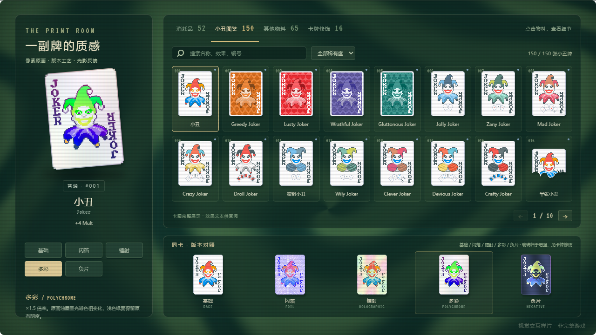
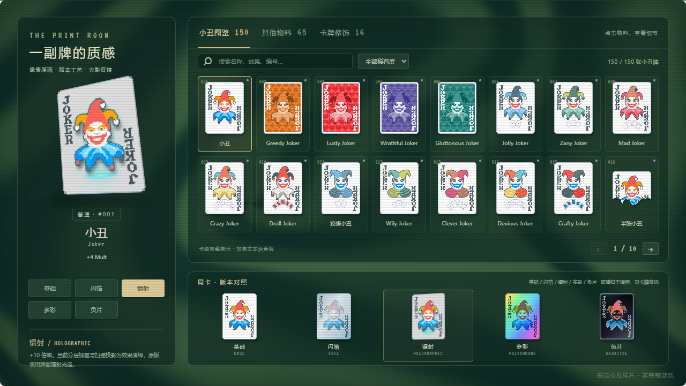
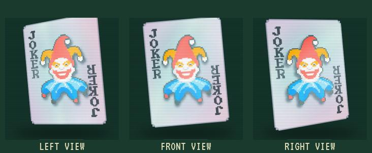
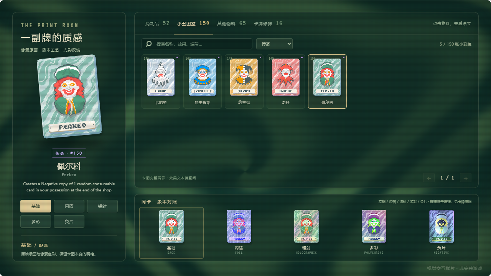

# 第二轮视觉调整确认

更新：2026-11-08。对应反馈：背景不流动、版本材质差异弱、小丑牌展示不完整且美术过于简化。

后续的玻璃透明牌体、材质细化、五类立体包装与最新物料数量见 [第三轮材质与卡包工艺](14-material-pack-polish.md)。本篇保留第二轮调整记录。

全息图像随后加入青紫轮廓光、扫描纹理、投影光束与信号扰动，最新截图与验证见 [全息投影追加](15-hologram-projection.md)。

直接打开 [物料与材质 Demo](http://127.0.0.1:5192/#materials)。已有页面刷新后即可查看。

## 背景流动

原样片的时间系数只有 `0.08`，波形变化很慢；WebGL 获取失败时还会直接返回静态色块。新版使用更明显的域扭曲、旋转与径向波形，保留绿色牌桌和棕红商店两套配色，约 25 FPS 绘制。主背景使用 960×540 WebGL，再缩放至舞台大小。

无 WebGL、着色器失败或上下文丢失时，切换到同样持续流动的 Canvas 2D 背景，内部低分辨率采样后平滑放大。减少动态时冻结当前时间，恢复后从当前位置继续；切回浏览器标签页也不会突然跨过一大段时间。

这些是参考原版视觉方向的自编参数，未宣称与原版 shader 相同。可在 [牌桌](http://127.0.0.1:5192/#table) 的中央空白区域观察旋涡连续运动。

## 材质对照

所有卡牌使用同一底图对照，避免把插画差异误认为材质差异。特殊轮廓使用卡图 alpha 蒙版，半张小丑等不会被反光层补成矩形。

| 项目 | 新版识别点 |
| --- | --- |
| 基础 | 原始纸面、颜色与图案 |
| 箔片 Foil | 冷银蓝金属色、细密压纹、窄幅镜面光与闪点 |
| 全息 Holographic | 纸面、悬浮图案、青紫边光和反光分层，随视角产生立体视差 |
| 多彩 Polychrome | 高饱和彩虹分色，纸面也有完整光谱渐变 |
| 负片 Negative | 纸面与图案明暗反转、冷色边光 |
| 玻璃 Glass | 低饱和透明蓝灰底、强高光切面与裂纹；单列为增强 |

左侧大卡可移动指针查看倾斜与反光，底部六张同卡可直接点击切换。静止时仍保持不同纸面和纹理；减少动态会关闭循环动画与指针倾斜。

### 全息追加优化：图案悬浮与立体视差

对应“平面效果缺少全息感”的反馈，改用 CSS 3D 层叠：纸面位于基准平面，内层纹理与青色像层位于中间，主体图案位于前方，最上层为随角度变化的反射。大卡的主体层距纸面 26 个逻辑像素，小卡为 12；指针驱动两个方向的旋转，主体相对纸面有可见位移，带层间阴影和青紫边光。未悬停时有缓慢的角度巡视，减少动态会冻结巡视、视差和反光交互。

已为 213 张源物料生成纸面/主体派生层，避免只复制整张卡片导致边框和文字一起浮起。通过背景连通区与中心区域规则提取主体；复杂插画的提取属于表现近似。这是有实际深度投影的 2.5D 图层，不是完整人物模型或真实光学全息模拟。卡图来源与版权沿用原始物料，派生索引记录源图哈希。

新增浏览器检查使用真实鼠标移动，确认主体相对纸面的投影在左右视角下向相反方向变化，并比较实际截图；同时检查小卡指针交互和减少动态后像素保持静止。实现时单独处理了 `preserve-3d` 容器命中父节点的情况，并关闭会使父层扁平化的 `filter` 和 `isolation`。

## 完整小丑视觉图鉴

补齐 **150 张不同卡图**，分布为普通 61、罕见 64、稀有 20、传奇 5。每页 16 张，共 10 页；支持按英文名称、已提供的中文别名、效果文本和编号搜索，支持稀有度筛选，并显示选中卡牌的名称、原文效果与收藏编号。

牌桌、计分样例和商店也使用这些卡图，替换第一轮 4 张简化人物稿。“其他物料”提供全部 63 张已有自绘稿，包含 52 张扑克牌、2 张卡背、2 张消耗品、3 张包装和4 种蜡封。

这是完整的视觉展示与文本查阅；150 种小丑能力尚未全部实现。原有三个计分小丑及多彩效果继续按样片规则工作，蓝图仍只演示购买与排序。

## 物料来源

小丑卡图取自 [Balatro Wiki 的 Joker 目录](https://balatrowiki.org/w/Jokers)，属于 LocalThunk / Playstack 的原版美术，作为本地还原研究参考使用；并非重新绘制，也不将 Wiki 的文字许可解释为游戏美术的开源授权。

- [150 张卡图联系表](../../research/joker-contact-sheet.jpg)。
- [精灵图集](../../public/assets/joker-atlas.png)与[全部 213 张物料索引](../../public/assets/manifest.json)。
- [逐图来源、尺寸与哈希](../../research/joker-art-manifest.json)。Hologram 原参考为 GIF，样片采用首帧；Wee Joker 的较大原图按最近邻缩放进入图集。
- [来源与版权说明](../../public/assets/THIRD-PARTY.md)。

## 验证与确认重点

自动检查会比较实际截图的 RGB 像素，而不只检查是否添加了动画类名：背景间隔 1.5 秒须有明显变化；减少动态后须完全静止；无 WebGL 时仍须有明显变化；六种材质在静止时逐对比较须有明显差异。逐页检查全部 150 张卡图加载完成且文件哈希各不相同，并检查四档稀有度、搜索、空结果与选中预览。

生产构建检查发现并修复了一个独立问题：CSS 自定义变量中的相对蒙版 URL 会按打包后的样式表路径解析，导致反光蒙版失效。现在按页面基址生成绝对物料 URL，保证开发和生产预览一致。另外通过主动丢失 WebGL 上下文检查了 Canvas 接管后图鉴界面仍可正常显示。

原有人工操作/接口共用状态、拖拽排序、购买/开包与两种计分顺序继续验证。结果见 [浏览器验证报告](../../research/browser-verification.json)。验证在桌面 Chrome 中进行；窄屏只检查整体缩放和无横向溢出，不视为移动端体验已验收。

本轮主要确认背景流速是否舒服、六种材质是否易认、全图鉴卡图与大卡预览是否满足后续还原方向。字体、其他物料精细度、完整规则与原版音频仍沿用 [原确认文档](12-lookdev-review.md) 中的后续范围。
