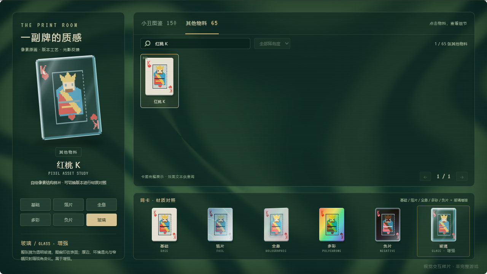
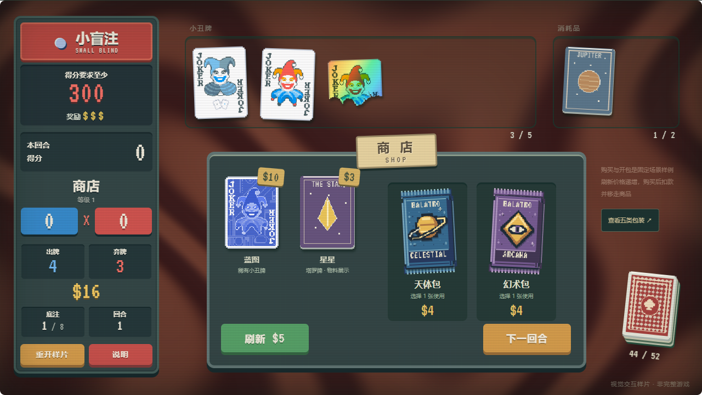
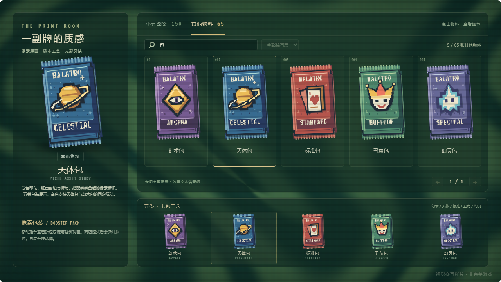
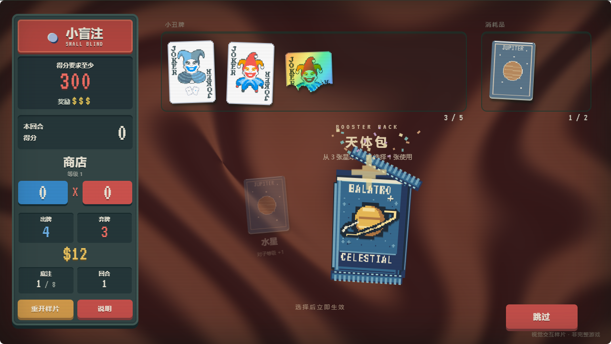

# 玻璃牌体与卡包工艺调整

更新：2026-11-08。对应反馈：继续优化各类材质，玻璃应当是卡牌本身的材质，卡包需要包装厚度、封边和立体标识。

卡包风格追加修正：上一版的金属渐变与细碎折痕偏向写实。本页卡包截图已更新为与牌桌协调的像素稿；用有限色阶、块状明暗和轻微折边表现厚度。

打开 [商店 Demo](http://127.0.0.1:5192/#shop) 或 [物料 Demo](http://127.0.0.1:5192/#materials)。商店右侧新增“查看五类包装”，可直接进入包装对照。

## 玻璃：透明牌体与表面印刷

去掉默认裂纹和不透明纸底。整张牌使用透明玻璃底，透出所在位置的背景；印刷图案与角标位于表面，边缘用窄亮边、内侧暗边、蓝绿色厚边和斜向反射表现切面。移动指针会改变牌体角度和反射位置。

为全部 **215 张源物料**生成透明印刷派生层，记录源图哈希与透明比例。提取时去除连通的纸底色，保留角标、图案与轮廓；暗色印刷稍提亮以便在深色桌面上辨认。复杂插画仍采用颜色与连通区近似，可能需要逐图修正。半张等特殊轮廓继续使用原图 alpha 蒙版。

这是 CSS 背景透射、轻度模糊与反光的视觉近似，未模拟真实玻璃的光线路径或物理折射。玻璃在玩法分类中仍属于增强，材质页允许同图对照不表示 Joker 实际拥有玻璃增强。

## 卡包：像素印花、封边与轻微厚度

五类包装重新绘制为 **64×104 像素**的袋面和图案，上下封条为 **64×10 像素**。采用有限调色板、整数坐标和无抗锯齿的字体印刷；放大使用最近邻显示。移除连续金属渐变、密集折痕、圆润鼓面与柔光，改用块状高光、深色轮廓和阶梯折边。包装依然保留侧边、锯齿压封及撕封虚线；图案只比袋面前移少量深度，鼠标倾斜幅度也已降低。

补齐五类视觉包装，并在缩略图、放大预览和对照区复用同一套结构。仅查看包装时，图鉴会使用更大的五列展陈，便于比较徽章和袋面细节。

| 包装 | 袋面与标识 |
| --- | --- |
| 幻术 Arcana | 紫色底、金色菱形与像素眼睛 |
| 天体 Celestial | 深蓝底、土星与阶梯轨道 |
| 标准 Standard | 赤红底、叠放扑克牌与红桃 |
| 丑角 Buffoon | 绿色底、彩色小丑帽与笑脸 |
| 幻灵 Spectral | 靛紫底、青白火焰幽灵 |

商店仍使用天体包和幻术包的固定交互样例；其余三类本轮补齐视觉展示，未新增完整卡池与游戏规则。

开包从顶部撕开封条、短暂露出袋口与像素星芒，再让空袋下落；候选牌依次展开。默认袋体离场约 650ms，封条约 470ms，候选从 230ms 起每隔 100ms 入场。包装动画按速度设置播放，减少动态时直接显示候选。快速跳过或切场景时清理对应包装，旧开包的延迟清理不会移除新开包。

## 其他材质与细节

- 箔片减少密集的亮纹和十字星光，改成细拉丝、稀疏压纹和窄幅金属反射。
- 多彩与负片补充随指针变化的局部反光，保留彩虹分色与深底冷光各自的识别点。
- 保留上一轮的分层全息，并持续检查前景与纸面的实际视差。
- 页首标识加上金色斜面、压印厚度和缓慢扫光；减少动态会停用扫光。
- 卡包预览显示包装工艺说明和五类包装对照，切回卡牌后恢复六种材质选择。

## 验证与物料

通过 TypeScript 检查、Vite 生产构建，以及开发和生产预览中的 **42 项 Chrome 浏览器检查**。最新报告保存在 [开发检查](../../research/browser-verification-development.json) 与 [生产检查](../../research/browser-verification-production.json)。

新增检查比较实际渲染结果：改变玻璃后方底色，验证变化透过牌体；使用普通纸牌作为遮挡对照。移动鼠标后测量凸印徽章相对袋面的投影偏移；检查五种包装展示、顶封撕开与袋体移除、切场景清理，以及玻璃和包装在减少动态时保持静止。原有 3,120 / 2,960 计分、购买扣款、目标塔罗、API 状态隔离、150 张卡图、背景降级和窄屏无横向溢出继续通过。

物料总数为 **215 = 150 张 Joker 参考图 + 65 张自绘结构稿**，其中包装包含 5 类。包装另有 15 张低分辨率分层精灵用于页面显示，不额外计入卡牌目录数量；Joker 图及派生层沿用 LocalThunk / Playstack 的原始版权归属。

- [透明印刷派生层索引](../../public/assets/glass/manifest.json)及[生成脚本](../../scripts/generate-glass.py)。
- [包装像素图生成脚本](../../scripts/generate-packaging.py)及[分层精灵索引](../../public/assets/packaging/manifest.json)。
- [包装结构与指针照明](../../src/packaging.ts)及[包装样式](../../src/packaging.css)。
- [材质样式](../../src/editions.css)与[全部源物料](../../public/assets/manifest.json)。

当前按桌面 Chrome 验证。窄屏仍采用整体舞台缩放；复杂插画的透明印刷、移动端性能与真实光学质感还需要后续细化。
