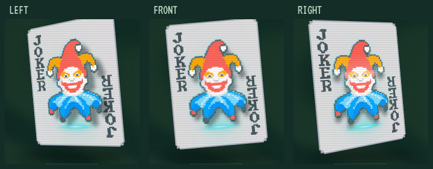
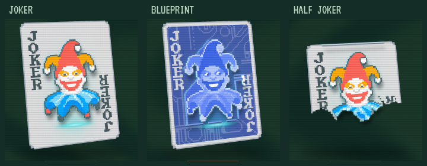

# 全息投影与原色立体层次

本篇为历史试验记录。2026-11-08 先统一原版名称为“镭射（Holographic）”，随后按新的“样式尽量接近原版”反馈，将悬浮主体、扫描线和投影光束替换为牌面三角镭射纹。下文截图、操作描述和检查结果对应旧试验，不代表当前页面；当前效果见[四种版本的原版风格对齐](17-original-edition-finishes.md)。

更新：2026-11-08。在赛博朋克投影效果上，按“立体感与颜色丢失”的反馈恢复原画色彩，并加强主体、侧边、落影和纸面的距离。

打开 [物料与材质](http://127.0.0.1:5192/#materials)，选择“镭射”。移动指针观察视差，停住指针观察图案上的扫描光和偶发信号扰动。底部同卡对照也使用同一套投影效果。

## 本轮表现

悬浮主体恢复原有的红帽、黄饰和蓝衣，保持不透明、清晰的像素原画；去掉主体的去色、青色重映射和透明扫描蒙版。纸面保留原图颜色，仅轻微压暗。青紫光效作为薄叠层，避免覆盖原画。蓝图等本身采用单色配色的卡图沿用其原色。

| 层次 | 表现 |
| --- | --- |
| 悬浮图像 | 原色正面，细青紫轮廓光；透明扫描纹理只叠加在主体上 |
| 立体侧边 | 主体后方 3 像素处的暗色副层，保留原画色相，形成薄侧边 |
| 牌面落影 | 主体轮廓阴影留在纸面上，随观察角度偏移，和悬浮主体产生明确分离 |
| 扫描光 | 约 3.8 秒一次的亮线扫过图案，按主体透明轮廓裁切 |
| 投影来源 | 纸面下方的窄发光口、淡网格与条状光束 |
| 信号扰动 | 约 7.4 秒一个周期，短暂出现两条错位色带；轮廓光轻微变化，原画持续保持清晰 |
| 粒子 | 少量青紫像素点向上飘，小卡减少粒子和光晕强度 |

大卡图像离纸面从 30 增加到 **40 个逻辑像素**，小卡沿用 12；实际通过 CSS 3D 投影产生视差。纸面、落影、投影口、光束、侧边、主体与扫描光位于不同深度，父容器保留 `preserve-3d`，不使用会把它们压平的分组滤镜。光晕只加在主体上。

所有投影层复用现有主体派生层，未增加卡牌目录条目。复杂插画的主体仍由连通背景启发式提取，属于 2.5D 视觉近似；本轮没有生成完整三维人物或物理光学全息。半张小丑等特殊轮廓继续保留透明区域，并修复了蒙版与发光滤镜组合导致的轮廓外光条。

“减少动态”会停止扫描、粒子、色带扰动、轮廓光变化和指针倾斜，保留原画配色、侧边、落影与静态光效。

## 验证

TypeScript 检查与 Vite 构建通过，开发和生产预览各通过 **44 项 Chrome 检查**，无浏览器错误或失败请求。大卡左右视角的总视差约 22.7 像素；原色对照中的红色与蓝色像素分别约 95% 与 94% 保持对应色彩分类。

浏览器验证新增原画颜色检查：固定镜头与动画，将实际呈现的红帽、蓝衣与相同姿态下的原色参考截图比较，分别验证色彩保留比例与 RGB 误差。左右指针姿态下，主体中心相对牌面的总位移要求超过 20 像素。扫描光仍通过固定其他动画、只改变扫描位置后的截图验证；减少动态后，移动指针并等待一段时间，投影像素应保持静止。原有六种材质差异、玻璃透射、像素包装与计分交互继续验证。

- [开发检查](../../research/browser-verification-development.json)、[生产检查](../../research/browser-verification-production.json)。
- [全息材质样式](../../src/holographic.css)、[共享指针控制](../../src/hologram.ts)。
- [截图采集脚本](../../scripts/capture-hologram.mjs)。

当前效果供视觉确认。动画在桌面 Chrome 检查，未据此认定移动设备性能已验收；卡图与派生层的版权来源沿用已有物料说明。
