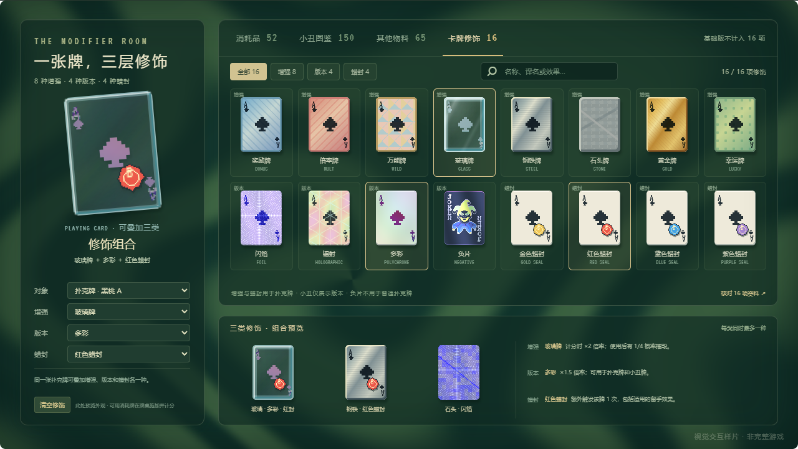
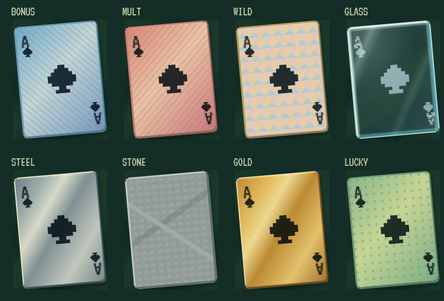

# 16 项卡牌修饰对齐

核对日期：2026-11-08。对应反馈：Balatro HQ 列了 16 项，当前 demo 的“六种材质”是否遗漏。

## 结论与计数

确实存在视觉覆盖缺口。原规则资料已收录 8 种增强、4 种非基础版本与 4 种蜡封，但之前的 demo 把基础、4 种版本和玻璃增强混在同一个材质选择器中；其他 7 种增强没有独立展示，4 种蜡封只是单独的 PNG，没有叠到牌面上。

[Balatro HQ 中文页](https://balatrohq.com/zh/enhancements/)的 16 是 **8 + 4 + 4**，不是 16 种同类别增强。[Balatro Wiki](https://balatrowiki.org/w/Card_modifiers)将基础版本也列入版本表，因此写为 5 种版本；排除基础后与 HQ 一致。

按本轮反馈重新核对原版简体中文名称：四种非基础版本是 **闪箔（Foil）、镭射（Holographic）、多彩（Polychrome）、负片（Negative）**。各 Wiki 条目的 “In other languages” 表与 HQ 中文页一致：[闪箔](https://balatrowiki.org/w/Foil#In_other_languages)、[镭射](https://balatrowiki.org/w/Holographic#In_other_languages)、[多彩](https://balatrowiki.org/w/Polychrome#In_other_languages)、[负片](https://balatrowiki.org/w/Negative#In_other_languages)。原版简体中文没有名为“全息”的独立增强或版本；旧 demo 的“全息”“箔片”仅保留为搜索词，界面条目和选择器统一使用原版名称。

两页已实时访问并保存快照与 SHA-256：[核对记录](../../research/modifier-alignment-audit.json)。HQ 的 S/A/B/C 推荐分级属于该站攻略评价，不作为游戏参数使用。

## 现在的视觉入口

打开[物料与材质](http://127.0.0.1:5192/#materials)，切到 **卡牌修饰 16**。右侧 16 张图鉴分别展示增强 8、版本 4、蜡封 4，可按类别筛选，按中文、英文、译名或效果搜索。左侧选择对象与三类修饰，底部提供三组组合预览。

| 类别 | 条目 | 规则摘要 | 视觉表现 |
| --- | --- | --- | --- |
| 增强 | 奖励 Bonus | 计分时 +30 筹码 | 蓝色纸面与斜纹 |
| 增强 | 倍率 Mult | 计分时 +4 倍率 | 红色纸面与斜纹 |
| 增强 | 万能 Wild | 同时视为所有花色 | 四色拼块，保留点数 |
| 增强 | 玻璃 Glass | ×2 倍率，出牌结算后有 1/4 概率摧毁 | 透明牌体、表面印刷与厚边 |
| 增强 | 钢铁 Steel | 留手时 ×1.5 倍率 | 冷灰金属纸面与反光 |
| 增强 | 石头 Stone | +50 筹码，无点数和花色，始终参与计分 | 石纹整面，隐藏点数与花色图案 |
| 增强 | 黄金 Gold | 回合结束留手时获得 $3 | 金色纸面与反光 |
| 增强 | 幸运 Lucky | 计分时分别有 1/5 概率 +20 倍率、1/15 概率获得 $20 | 绿色点阵纸面 |
| 版本 | 闪箔 Foil | +50 筹码 | 蓝紫金属底、同心环与十字反光 |
| 版本 | 镭射 Holographic | +10 倍率 | 牌面三角衍射纹与粉青紫光泽 |
| 版本 | 多彩 Polychrome | ×1.5 倍率 | 原画油墨色相变化，保留浅色纸面 |
| 版本 | 负片 Negative | +1 对应槽位 | 深蓝底、浅色文字与亮色负像 |
| 蜡封 | 金色 Gold | 打出并计分时获得 $3 | 金色像素蜡封叠在牌面 |
| 蜡封 | 红色 Red | 额外触发该牌 1 次，包括适用的留手效果 | 红色像素蜡封叠在牌面 |
| 蜡封 | 蓝色 Blue | 回合结束留手时生成最后打出牌型对应的星球牌，需空位 | 蓝色像素蜡封叠在牌面 |
| 蜡封 | 紫色 Purple | 弃掉时生成塔罗牌，需空位 | 紫色像素蜡封叠在牌面 |

## 组合与适用范围

普通扑克牌可以同时拥有增强、版本、蜡封各一种。新入口支持玻璃＋多彩＋红封、钢铁＋红封、石头＋闪箔三个预设；下拉选择可以继续改其中一类，并保留其他两类。这是可随时切换的视觉组合器，不是游戏中的施加操作；规则中增强和蜡封可以被新的一种覆盖，版本通常不能被覆盖。

小丑牌不能添加增强和蜡封。选择负片会切到小丑牌并清空不适用的两类修饰；切回扑克牌会移除负片。负片也能用于特定方式生成的消耗牌，当前组合器不展示消耗牌对象。功能贴纸 Eternal、Perishable、Rental 属于另外一类，不包含在这 16 项内。

原“同卡材质对照”已改为“同卡版本对照”，不再混入玻璃。小丑图鉴展示基础和四种版本；扑克牌展示基础、闪箔、镭射、多彩，排除负片。切换物料时清除不适用的版本。玻璃统一在“卡牌修饰 → 增强”中预览与组合，不再给小丑展示玻璃增强。特殊负片消耗牌仍可在消耗牌物料上预览；卡包、卡背、蜡封物料不套用版本。

## 实现与边界

- [修饰目录与交互](../../src/modifiers.ts)：16 项、译名、效果、来源、对象限制与组合预设。
- [表面着色器](../../src/edition-renderer.ts)与[增强材质](../../src/modifiers.css)：复用现有源图，保持增强、版本和蜡封叠层，不增加 215 张基础物料的数量。
- [浏览器验证](../../scripts/browser-verify.mjs)：16 项逐项加载、8/4/4 分类、镭射译名检索、组合与负片对象限制，以及八种增强的实际截图差异。

中文命名、分类和组合检查已通过。后续四种版本的风格重做与最新验证详见[原版风格对齐](17-original-edition-finishes.md)和[浏览器报告](../../research/browser-verification.json)，检查覆盖简体中文主名称、旧称搜索、适用对象、组合实际像素变化与新版本材质。

本轮补齐的是视觉目录和组合操作，不是完整规则引擎。表中计分、概率、销毁、留手收入、消耗牌生成和额外触发尚未全部接入样片玩法；公开 API 仍只暴露 `getState()` 与 `dispatch(action)`。此前的 2.5D 投影已由后续牌面光泽替换，当前着色器依据原版参考图独立编写，仍不代表原版算法的逐像素还原。
