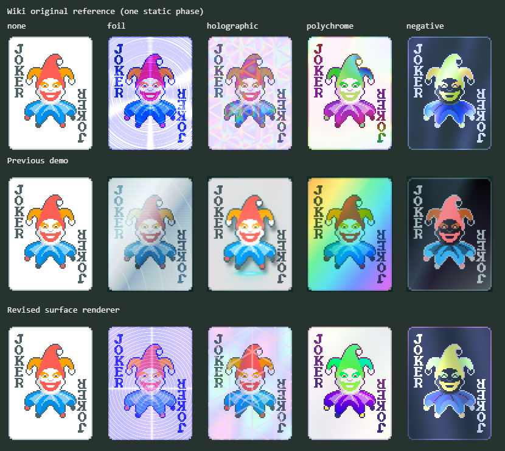
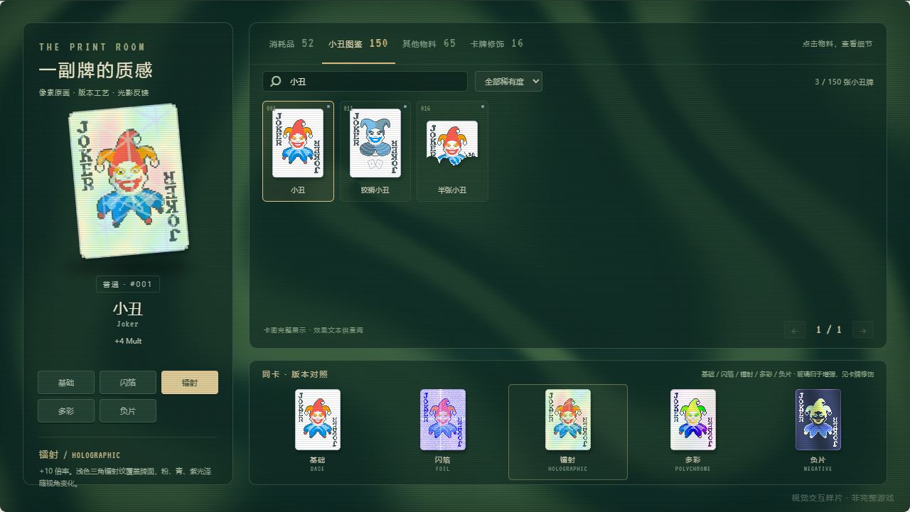

# 四种版本的原版风格对齐

更新：2026-11-08。按“闪箔、镭射、多彩、负片尽量接近原版”的反馈，重做四种牌面效果。打开[物料与材质](http://127.0.0.1:5192/#materials)，小丑图鉴下方可直接同卡对照；“卡牌修饰 16”中仍可组合增强、版本和蜡封。

## 对照依据与修改

参考 Balatro Wiki 收录的[闪箔](https://balatrowiki.org/w/Foil)、[镭射](https://balatrowiki.org/w/Holographic)、[多彩](https://balatrowiki.org/w/Polychrome)、[负片](https://balatrowiki.org/w/Negative)原版 Joker 效果图，保存原生 142 × 190 像素参考及来源、时间和 SHA-256：[参考索引](../../research/edition-references/manifest.json)。参考图片仅存于研究目录，版权仍属 LocalThunk / Playstack，不加入运行时公共物料。

| 版本 | 本次调整 |
| --- | --- |
| 闪箔 | 银蓝渐变改为偏蓝紫的金属底、密集同心环刻纹与十字镜面反光，原画油墨也参与反光 |
| 镭射 | 悬浮主体、光束、发射口、扫描线、粒子退出当前样片；改为与原画共面的三角衍射纹、粉青紫浅色反光 |
| 多彩 | 不再给整张牌盖高饱和彩虹；按原画像素改变色相，保留浅色纸面与原有阴影层次 |
| 负片 | 黑底加反色滤镜改为深蓝负像底、浅色文字与亮色图案，叠加缓慢的光谱反射 |

四种效果都是牌面表面处理，大卡、小卡、修饰图鉴、组合预览和牌桌共用渲染，不再提取或抬升原画主体。旧投影代码及截图保留为[此前试验记录](15-hologram-projection.md)，不再被当前页面加载。

## 实现与组合

[edition-renderer.ts](../../src/edition-renderer.ts)是独立编写的 WebGL 牌面着色器。一个共享上下文为可见版本生成原生尺寸画面，采用最近邻采样保留像素边缘；图案、文字和透明轮廓使用同一张源图。动态按约 30 FPS 更新，指针改变反光相位；减少动态会冻结时间与指针影响。没有新增对外 API。

增强底材先参与着色，再叠加蜡封。石头不重新露出点数与花色；玻璃使用透明表面印刷作为输入，保留透光牌体；半张小丑等特殊卡图继续保留原图透明轮廓。无 WebGL、着色器编译失败或上下文丢失时使用[CSS 近似样式](../../src/editions.css)，仍可操作页面。

## 验证与边界

TypeScript 检查与 Vite 构建通过，生产预览通过 **51 项 Chrome 检查**，没有浏览器错误、失败请求或运行时外部请求。检查覆盖四种版本的实际像素动态、指针反光、与原版参考的纸面色调差异、半张小丑透明轮廓、减少动态、组合叠层和 CSS 降级；保留原有选牌、计分、商店、开包、150 张小丑加载与窄屏检查。详见[生产验证报告](../../research/browser-verification-production.json)。

[静态对照记录](../../research/edition-visual-comparison.json)使用参考图不透明区域的平均 RGB 绝对误差（0–255）辅助观察：

| 版本 | 旧样片 | 本次 |
| --- | ---: | ---: |
| 闪箔 | 42.0 | 22.5 |
| 镭射 | 30.3 | 19.8 |
| 多彩 | 68.2 | 15.7 |
| 负片 | 36.4 | 17.1 |

该比较只对应一组静态参考相位；旧截图缩放到参考尺寸，不能换算成“还原百分比”。本次依据公开效果图独立重建表现，没有逐帧录制原版客户端；动态速度、反光相位和数学实现仍是近似。16 项规则的完整计分、概率与触发实现不在此次材质调整范围内。

可通过 `node scripts/capture-editions.mjs` 重新生成当前对照图和误差记录；研究参考与改动前截图已固定保存。
